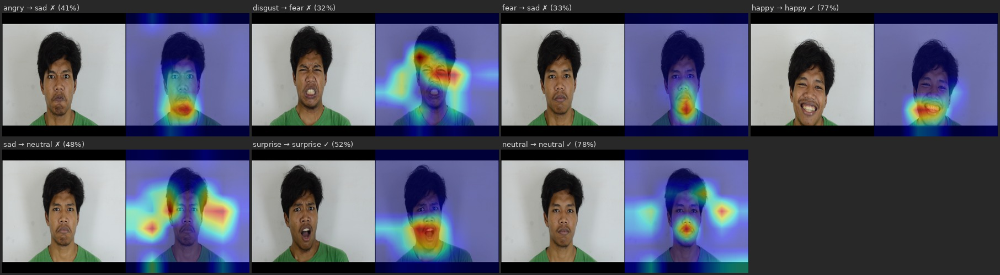

# Video Swin Transformer with Temporal Depth Enhancement for Mixed Emotion Recognition on the IMED Dataset

This repository contains code and experimental results investigating the effectiveness of a **Temporal Depth Enhancement (TD)** module on the **Video Swin Transformer** architecture for video-based Facial Expression Recognition (FER). Experiments use the IMED "VIDEO MIXED EMOTION" dataset with Leave-One-Subject-Out (LOSO) evaluation and Wilcoxon signed-rank test for statistical validation.

---

## Research Questions

- **RQ1:** Does integrating a Temporal Depth Enhancement (TD) module into Video Swin Transformer improve video-based FER on the IMED dataset, and which TD variant is most effective?
- **RQ2:** Is the performance gain of the proposed method over the backbone-only baseline statistically significant?
- **RQ3:** To what extent does identity leakage in random-split evaluation inflate reported metrics in prior work?

---

## Repository Structure

```
2026-imed-vst/
├── src/
│   ├── config.yaml                    # Centralized config (dataset, model, training)
│   ├── dataset.py                     # IMEDVideoDataset: LOSO & random split, VideoTransform
│   ├── model.py                       # VideoSwinFER + TemporalEnhancement (TD) module
│   ├── train.py                       # train_one_epoch, evaluate, build_optimizer
│   ├── metrics.py                     # WAR, UAR, MacroF1, W-F1, per-class recall
│   ├── run_ablation.py                # Step 0: temporal window search
│   ├── run_loso.py                    # Step 1–4: LOSO + multi-seed
│   ├── run_step5_td_ablation.py       # Step 5: TD architecture ablation
│   ├── run_step6_wilcoxon.py          # Step 6: Wilcoxon signed-rank test
│   ├── run_step7_identity_leakage.py  # Step 7: label permutation test (supplementary)
│   ├── run_random_split_exp.py        # Step 7: identity leakage (LOSO vs random split)
│   ├── run_gradcam.py                 # GradCAM visualization
│   ├── run_inference_timing.py        # Inference timing benchmark
│   ├── stat_significance.py           # Per-pair Wilcoxon (optional)
│   └── summarize_results.py           # Aggregate all results → outputs/all_results_summary.csv
│
├── dataset/
│   └── VIDEO MIXED EMOTION/           # Frame JPGs per subject per emotion (not in git)
│
├── outputs/
│   ├── results/                       # CSV & TXT results per step
│   │   └── all_results_summary.csv    # Aggregated results (34 rows)
│   └── runs/                          # Model checkpoints per fold per seed
│
├── paper-writing/
│   ├── experiment_design_v2.md        # V2 experiment design (protocol & order)
│   ├── paper_draft_results.md         # Draft results section
│   └── slr_imed.md                    # Systematic Literature Review
│
├── v1/                                # V1 experiments (deprecated — val=test leakage)
├── environment.yml                    # Conda environment: ksn_cv_task
└── README.md
```

---

## Model

### Backbone: Video Swin Transformer

| Backbone | Params | feat_dim | Pretrained |
|---|---|---|---|
| `swin3d_t` | 28M | 768 | Kinetics-400 |
| `swin3d_s` | 49M | 768 | Kinetics-400 |

**Selected:** `swin3d_s` (Step 1 → WAR 63.54% vs swin3d_t 53.33%)

> Ze Liu, Jia Ning, Yue Cao, Yixuan Wei, Zheng Zhang, Stephen Lin, Han Hu. **Video Swin Transformer.** *CVPR 2022*. DOI: https://doi.org/10.1109/CVPR52688.2022.00320

### Temporal Depth Enhancement (TD) Module

Inserted after the backbone `norm` layer, replacing `avgpool`:

```
[B, D', H', W', C]
  → spatial avg pool H'×W'  → [B, D'=8, C=768]
  → encoder                 → [B, *, C]
  → temporal pool           → [B, C]
  → head (LayerNorm → Dropout → Linear)
```

| Variant | Encoder | Layers | PE | FFN | Pool | WAR (seed=42) |
|---|---|---|---|---|---|---|
| `td_base` | transformer | 1 | ✗ | 1536 | mean | 61.59% |
| `td_pe` | transformer | 1 | ✓ | 1536 | mean | 61.11% |
| `td_2l` | transformer | 2 | ✗ | 1536 | mean | 59.68% |
| `td_4x` | transformer | 1 | ✗ | 3072 | mean | 63.18% |
| `td_cls` | transformer | 1 | ✗ | 1536 | cls | 62.86% |
| `td_full` | transformer | 2 | ✓ | 3072 | cls | 63.65% |
| `td_pe_cls` | transformer | 1 | ✓ | 1536 | cls | 63.49% |
| `td_maxpool` | none | — | — | — | max | 60.79% |
| **`td_gru`** | BiGRU | 1 | — | 1536 | — | **65.71%** |

**Selected:** `td_gru` (BiGRU 1 layer, best in Step 5 ablation search — WAR 65.71%)

### Inference Overhead

| Model | Params | ms/clip | clips/s |
|---|---|---|---|
| swin3d_t no-TD | 27.9M | 25.39 | 39.4 |
| swin3d_s no-TD (baseline) | 49.5M | 42.74 | 23.4 |
| **swin3d_s td_gru (proposed)** | **52.2M** | **44.23** | **22.6** |

TD overhead: **+1.49 ms/clip (+3.5%)**

---

## Experiment Matrix

| Step | Experiment | Condition | Seeds | Total runs |
|---|---|---|---|---|
| Step 0 | Temporal window search | 5 configs (A–E) | 3 | 15 |
| Step 1 | Backbone comparison | swin3d_t, swin3d_s | 3 | 90 |
| Step 2 | Loss function | CE, focal | 3 | 45 |
| Step 5 | TD ablation | 9 variants | 1 | 135 |
| Step 3 | TD module 7-class | td_gru, td_gru+freeze | 3 | 90 |
| Step 4a | Two-stage 19-class | twostage | 3 | 45 |
| Step 4b | Direct 19-class | no-TD, td_gru | 3 | 90 |
| Step 6 | Wilcoxon test | — | — | — |
| Step 7 | Identity leakage | LOSO vs random | 3 | 45 |

**Total:** ~555 training runs

---

## Training Parameters

| Parameter | Value |
|---|---|
| Optimizer | AdamW |
| Learning rate | 1e-4 (backbone: lr × 0.1) |
| Min LR | 1e-6 |
| Weight decay | 0.05 |
| Clip grad | 5.0 |
| Scheduler | Cosine + warmup 5 epochs |
| Epochs | 50 |
| Batch size | 8 |
| Loss | CE + label smoothing 0.1 |
| Mixed precision | fp16 (Turing arch) |
| Freeze epochs (two-stage) | 10 |

**Checkpoint selection:** val UAR (strict `>`)

---

## Dataset

**IMED "VIDEO MIXED EMOTION"** — available at https://imed.cs.ui.ac.id/

| Attribute | Value |
|---|---|
| Clips | 279 videos |
| Subjects | 15 (S1–S15) |
| Frames | Extracted to JPG |
| Basic classes (`emotion_set=basic`) | 7: angry, disgust, fear, happy, neutral, sad, surprise |
| All classes (`emotion_set=all`) | 19: 7 basic + 12 compound |
| Selected temporal config | T=16, interval=2, window=32fr |

If you use this dataset, please cite:

> Dewi Yanti Liliana, T. Basaruddin, Imelda Ika Dian Oriza. **The Indonesian Mixed Emotion Dataset (IMED): A Facial Expression Dataset for Mixed Emotion Recognition.** In *Proceedings of the 2018 International Conference on Artificial Intelligence and Virtual Reality (AIVR 2018)*. ACM, New York, NY, USA, 56–60. DOI: https://doi.org/10.1145/3293663.3293671

**Evaluation protocol (LOSO):**
```
Fold f (1–15):
  test_subject = subject f
  val_subject  = subject ((f+1) mod 15)   ← circular, disjoint from test
  train        = remaining 13 subjects
```

**Metrics:** WAR (= accuracy), UAR (= macro-recall), Macro-F1, W-F1

---

## Environment

```bash
conda env create -f environment.yml
conda activate ksn_cv_task
```

| Library | Version |
|---|---|
| Python | 3.10 |
| PyTorch | 2.2.2+cu121 |
| torchvision | 0.17.2 |
| scikit-learn | 1.6.1 |
| scipy | 1.15.2 |
| wandb | 0.25.1 |

**Hardware:** Quadro RTX 8000 (48GB), CUDA 12.1

---

## Reproduction

```bash
# Step 0 — temporal window search (swin3d_t, backbone frozen)
conda run -n ksn_cv_task python src/run_ablation.py --seeds 42 123 456

# Step 1 — backbone comparison
conda run -n ksn_cv_task python src/run_loso.py \
    --backbone swin3d_t --run_name step1_swin3d_t_7cls --seeds 42 123 456
conda run -n ksn_cv_task python src/run_loso.py \
    --backbone swin3d_s --run_name step1_swin3d_s_7cls --seeds 42 123 456

# Step 2 — loss function (swin3d_s selected)
conda run -n ksn_cv_task python src/run_loso.py \
    --backbone swin3d_s --loss_type focal \
    --run_name step2_focal_7cls --seeds 42 123 456

# Step 5 — TD ablation (single seed, search step)
conda run -n ksn_cv_task python src/run_step5_td_ablation.py

# Step 3 — TD module 7-class (td_gru selected from Step 5)
conda run -n ksn_cv_task python src/run_loso.py \
    --backbone swin3d_s --use_td --td_variant td_gru \
    --run_name step3_td_gru_7cls --seeds 42 123 456

# Step 4a — two-stage 19-class
conda run -n ksn_cv_task python src/run_loso.py \
    --emotion_set all --use_td --td_variant td_gru \
    --init_checkpoint_dir outputs/runs/step3_td_gru_7cls \
    --run_name step4a_twostage_19cls --seeds 42 123 456

# Step 4b — direct 19-class (no-TD)
conda run -n ksn_cv_task python src/run_loso.py \
    --emotion_set all --run_name step4b_direct_notd_19cls --seeds 42 123 456

# Step 4b — direct 19-class (td_gru)
conda run -n ksn_cv_task python src/run_loso.py \
    --emotion_set all --use_td --td_variant td_gru \
    --run_name step4b_direct_td_gru_19cls --seeds 42 123 456

# Step 6 — Wilcoxon test
conda run -n ksn_cv_task python src/run_step6_wilcoxon.py \
    --baseline step1_swin3d_s_7cls --proposed step3_td_gru_7cls

# Step 7 — identity leakage (LOSO vs random split)
conda run -n ksn_cv_task python src/run_random_split_exp.py \
    --loso_csv outputs/results/step3_td_gru_7cls_s42.csv --seeds 42 123 456

# Aggregate all results
python src/summarize_results.py
```

---

## Main Results

### 7-Class FER (LOSO, 3 seeds × 15 folds, mean ± std)

| Experiment | WAR | UAR | Macro-F1 | W-F1 |
|---|---|---|---|---|
| swin3d_t no-TD | 53.33% ± 14.41% | 51.75% ± 13.79% | 42.06% ± 15.60% | 43.42% ± 16.48% |
| swin3d_s no-TD (**baseline**) | 63.54% ± 16.65% | 61.59% ± 15.98% | 53.57% ± 18.46% | 55.34% ± 19.41% |
| swin3d_s + CE → Focal loss | 62.80% ± 15.76% | 60.95% ± 15.18% | 52.61% ± 17.60% | 54.26% ± 18.51% |
| swin3d_s + td_gru (**proposed**) | **64.13% ± 16.65%** | **62.22% ± 16.17%** | **54.26% ± 18.80%** | **56.03% ± 19.66%** |

**Wilcoxon signed-rank test** (td_gru vs baseline, 45 pairs):
`p-value (one-sided) = 0.5813`, `r = 0.031 (negligible)` → NOT significant (α = 0.05)

> **Additional run:** swin3d_s + td_full (transformer 2L+PE+CLS) direct fine-tune multi-seed → WAR 64.92% ± 16.52% (`exp_td_full_ext`)

### 19-Class Compound FER (LOSO, 3 seeds × 15 folds)

| Experiment | WAR | UAR | Macro-F1 |
|---|---|---|---|
| swin3d_s no-TD direct | 27.90% ± 7.78% | 27.37% ± 7.79% | 18.94% ± 7.50% |
| swin3d_s + td_gru direct | 29.70% ± 10.45% | 29.12% ± 10.33% | 22.01% ± 9.71% |
| swin3d_s + td_gru two-stage | 27.51% ± 8.59% | 27.02% ± 8.61% | 19.52% ± 8.27% |

### Identity Leakage Experiment

| Condition | n | WAR | UAR | Macro-F1 |
|---|---|---|---|---|
| **LOSO** (disjoint subjects) | 15 | 65.71% ± 21.45% | 63.81% ± 20.78% | 56.32% ± 24.02% |
| Random 60/20/20 (leaked) | 3 | 38.10% ± 6.74% | 38.10% ± 6.74% | 34.70% ± 7.15% |

---

## GradCAM Visualization

GradCAM activations from `swin3d_s + td_gru` (seed=42, fold 1). Format: original frame | activation heatmap. Label format: `ground truth → predicted ✓/✗ (confidence%)`.



---

## Conclusion

- The TD module (td_gru) improves WAR by **+0.59%** (64.13% vs 63.54%) over the baseline, but the improvement is **not statistically significant** (p=0.5813, Wilcoxon one-sided). Inter-fold variance is high (std ±16–19%) due to the small dataset size (279 clips, 15 subjects).
- The **td_gru** variant (BiGRU 1 layer) achieved the best performance in Step 5 ablation search (WAR 65.71% seed=42) and was selected as the proposed method with multi-seed WAR **64.13%**.
- TD overhead is only **+3.5%** (44.23 vs 42.74 ms/clip), adding 2.7M parameters to the 49.5M backbone.
- Focal loss does not improve over CE loss on this dataset.
- Two-stage training does not prove effective for transfer to 19-class compound FER.
- The identity leakage experiment shows that evaluation protocol has a large impact on result interpretation — the gap between our LOSO result (65.71%) and random split (38.10%) reflects training data size differences, while the gap between our random split (38.10%) and prior work's random split (~97–98%) demonstrates identity leakage bias in prior evaluations.

---

## Researchers

- Kuncahyo Setyo Nugroho (Bina Nusantara University)
- Miftakhurrokhmat (STMIK AMIKOM Surakarta)
